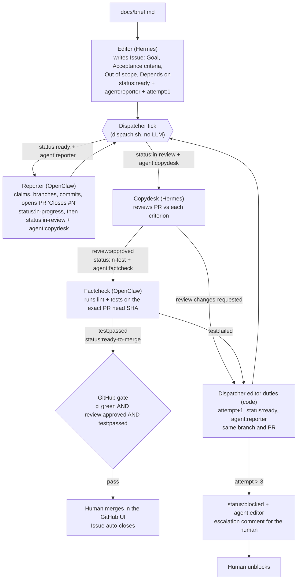
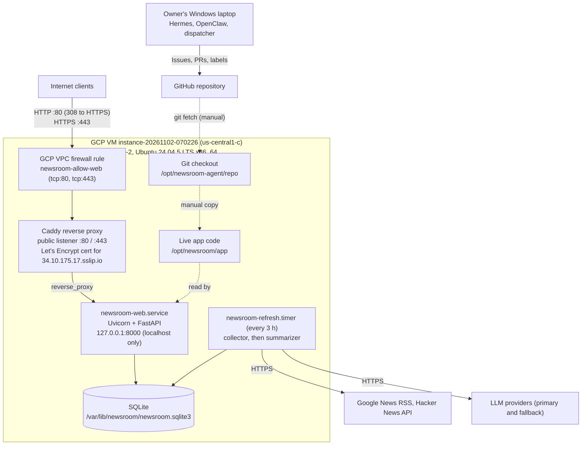

# Autonomous Newsroom: Delivery Report

*Verified against GitHub, the repository and local runtime records on November 2, 2026 (`main` at `93dce88`). All times are UTC.*

**Contents**
[1. Overview](#1-project-overview) · [2. Agent roster](#2-agent-roster) · [3. Architecture and workflow](#3-architecture-and-workflow) · [4. What was delivered](#4-implementation-delivered) · [5. Validation evidence](#5-validation-evidence) · [6. Failures and recovery](#6-failure-and-recovery) · [7. Deployment status](#7-deployment-status) · [8. Reproduction](#8-reproduction) · [9. Limitations and next steps](#9-limitations-and-next-steps) · [10. Conclusion](#10-conclusion)

**Links:** repository [Lakshmi-Sayyapureddy1819/autonomous-newsroom](https://github.com/Lakshmi-Sayyapureddy1819/autonomous-newsroom) · live site <https://34.10.175.17.sslip.io/> · token report [docs/token-report.md](docs/token-report.md) · protocol [agents/PROTOCOL.md](agents/PROTOCOL.md)

---

## 1. Project overview

**Product.** A small news site that updates itself, on the beat "latest AI/ML news". A scheduled job collects public items (Google News RSS search feed and the Hacker News Algolia API, neither needs a key), a model writes a one-line summary and a topic tag for each item, and the rows are stored in SQLite. A FastAPI page lists the articles with summary, tag and source link, shows "Updated X ago", and offers tag filters, search, an RSS feed and a run-history page (`/runs`). The summarizer tries a primary free model and falls back to a second one on HTTP 402/429. The UI was later branded "Synapse".

**What the assignment actually tests.** The product is the excuse; the delivery team is the test. The repository therefore contains a small team of agents on two runtimes, coordinated only through GitHub Issues and PRs:

- **Hermes Agent** runs the orchestrator (editor) and reviewer (copydesk) roles.
- **OpenClaw** runs the builder (reporter) and tester (factcheck) roles.
- A **dispatcher** (ordinary Python, no LLM) watches GitHub labels and wakes the one agent whose turn it is.
- **GitHub Actions** (`ci`, `gate`) block a PR unless checks pass and the PR carries both `review:approved` and `test:passed`.
- **The human owner is the only one who merges.**

```text
GitHub Issues + PRs (the only channel)
   ▲ labels, comments, branches      ▲ checks
   │                                 │
Dispatcher ──wakes one agent──►  Editor · Reporter · Copydesk · Factcheck
 (stdlib Python, no LLM)          (Hermes) (OpenClaw) (Hermes)  (OpenClaw)
```

Everything below distinguishes what was **verified**, what is **owner-reported**, and what was **not done**.

---

## 2. Agent roster

Role definitions live in [`agents/hermes/profiles/`](agents/hermes/profiles) (`SOUL.md` per profile) and [`agents/openclaw/`](agents/openclaw) (`AGENTS.md` per agent). The shared contract is [`agents/PROTOCOL.md`](agents/PROTOCOL.md). Models are the ones recorded in runtime session stores or commit trailers; an agent did not always use the same model.

| Agent | Runtime | Role | Model(s) actually recorded | Tools / boundary | What it actually did |
|---|---|---|---|---|---|
| **editor** | Hermes (`editor` profile) | Orchestrator: turns the brief into Issues, assigns, escalates | `nvidia/nemotron-3-ultra-550b-a55b:free` (UI-polish tickets session). Model for the T0–T4 ticket creation is **not recorded** (no matching session found) | `gh` Issues/labels/comments. No product edits, no merge | Wrote the Issues for T0–T3 (#1, #3, #5, #7; each has an editor handoff comment) and the UI-polish set #14–#18 ([handoff comment on #14](https://github.com/Lakshmi-Sayyapureddy1819/autonomous-newsroom/issues/14)). No editor comment exists on #9 or #12, so the editor's authorship of those two is not evidenced. Routine retry/escalation duties are done by dispatcher code, not by this agent |
| **reporter** | OpenClaw | Builder: implements one Issue, opens/updates its PR | Mostly `google/gemini-2.5-flash`; `google/gemini-3.7-flash` in one Issue #12 run; free OpenRouter models in default sessions. 6 early commit trailers say `qwen-2.5-coder-32b`, which **no runtime record supports** | Git, `gh`, shell, files. No merge | Authored 27 of the 29 trailer-bearing commits on `main` (T0–T5 work and fixes). Also the PR #25 scope cleanup |
| **copydesk** | Hermes (`copydesk` profile) | Reviewer: PR against acceptance criteria | `gemini-2.5-flash` when it responded; configured free `google/gemma-4-31b-it:free` attempts all hit HTTP 429 | PR diff, comments, review labels. No push, no merge | LLM reviews that rejected T2, T3 and PR #13 (see [traces](agents/traces)). For PR #25 a **deterministic script** ran instead |
| **factcheck** | OpenClaw | Tester: runs the PR head | Configured `nvidia/nemotron-3.5-lightning:free`; the only recorded run (Issue #12) used it and ended `failed`. Models for T2/T3 runs not recorded | Checkout, lint, tests, verdict labels. No push, no merge | LLM-driven tests for T2/T3 (40 passing tests recorded on Issue #7). For PR #25 a **deterministic script** ran instead |
| **human (owner)** | – | Merges, unblocks, owns credentials and infra | – | Terraform, secrets, branch protection, final merge | Only role permitted to merge; unblocked and re-routed Issue #14 and directed the PR #25 cleanup (section 5) |

**Why this split.** Builder and tester sit on OpenClaw, which has a per-agent workspace and shell; planner and reviewer sit on Hermes, which has profiles and is cheap for read-mostly work. Every agent holds one role, and tester and reviewer cannot push, so a bad PR must be stopped by someone other than its author.

**Not agent work (disclosed).** Commit `4b4f629` (PR #26, Synapse branding) is trailed `Agent: human`, `Model: claude-sonnet-5-5`: it was made with Claude Code at the owner's direction and touched 14 files including app templates and tests. The audits, manual label corrections and docs PRs were also done in Claude Code sessions. See [section 5](#5-validation-evidence).

---

## 3. Architecture and workflow

### 3.1 Ticket lifecycle



Agents act as the repository owner's GitHub user, so identity is proven by commit trailers (`Agent`, `Runtime`, `Model`, `Ticket`, `Co-authored-by`) and by the agent named in each handoff comment, not by the GitHub actor. CI's `trailer-check` fails a PR that changes `app/` or `deploy/` without them.

### 3.2 Labels as the state machine

| Label | Meaning | Set by |
|---|---|---|
| `status:ready` / `in-progress` / `in-review` / `in-test` / `ready-to-merge` / `blocked` | Where the ticket is | editor, reporter, copydesk, factcheck, dispatcher |
| `agent:<role>` | Who owns the next step (exactly one) | editor or the handing-off agent |
| `review:approved` / `review:changes-requested` | Review verdict (on the PR) | copydesk |
| `test:passed` / `test:failed` | Test verdict (on the PR) | factcheck |
| `attempt:<n>` | Build attempt, 1 to 3 | dispatcher |

### 3.3 Dispatcher behaviour

Code: [`agents/dispatcher/dispatch.py`](agents/dispatcher/dispatch.py), [`editor_lifecycle.py`](agents/dispatcher/editor_lifecycle.py), docs in [`agents/dispatcher/README.md`](agents/dispatcher/README.md).

- **Wake-up.** Each tick polls open Issues and their PRs' verdict labels through `gh`, then wakes only the agent in the single `agent:*` label. It wakes nobody for `status:ready-to-merge` or `status:blocked`.
- **Editor duties as code.** Rejected tickets get `attempt+1` and go back to `agent:reporter`; a third failure sets `status:blocked` and `agent:editor` with an escalation comment; tickets waiting on `Depends on:` are promoted when their dependencies close. The Hermes editor is woken only to author tickets from the brief.
- **Locking.** One lock file per agent in the state directory, so agents run in parallel but never twice at once. A lock older than the agent timeout is treated as stale.
- **Retry and backoff.** One JSON state file per ticket records failures. A non-zero exit, a timeout, or an exit 0 with no label change counts as a failure. Defaults: timeout 900 s, 40 turns, backoff 60 s (30× longer after HTTP 402/429), three failures maximum.
- **Output sanitising.** Token patterns are redacted before output reaches state, logs or comments.
- **Deterministic review/test mode** (`NEWSROOM_REVIEW_MODE=deterministic`). Added because free models were rate-limited. Copydesk and Factcheck then run [`copydesk_agent.py`](agents/scripts/copydesk_agent.py) and [`factcheck_agent.py`](agents/scripts/factcheck_agent.py). Copydesk checks only: PR closes one Issue, not a draft, no conflicts, `ci` green. Factcheck needs `review:approved` and green `ci`, runs `ruff` and `pytest` on the exact head SHA in a throwaway worktree, and writes `test:passed` or `test:failed` only from that result. **Neither reads the acceptance criteria.**

### 3.4 Automatic versus human actions

| Step | Who |
|---|---|
| Writing Issues | Editor agent (LLM) |
| Claim, branch, code, PR | Reporter agent (LLM, OpenClaw), woken by the dispatcher |
| Review verdict | Copydesk: LLM for T2, T3, PR #13; **script** for PR #25 |
| Test verdict | Factcheck: LLM for T2, T3; **script** for PR #25 |
| Retry routing, blocking, escalation | Dispatcher code |
| **Starting each dispatcher tick** | **Human (manual)**: no unattended scheduler was running for the validated runs |
| Unblocking, re-labelling, scope decisions, merging | Human |

---

## 4. Implementation delivered

All code below was merged to `main` through reviewed PRs.

| Ticket | Issue / PR | What was delivered |
|---|---|---|
| T0 | [#1](https://github.com/Lakshmi-Sayyapureddy1819/autonomous-newsroom/issues/1) / [#2](https://github.com/Lakshmi-Sayyapureddy1819/autonomous-newsroom/pull/2) | README roster (docs only) |
| T1 | #3 / #4 | Installable Python package, SQLite schema, test harness |
| T2 | #5 / #6 | RSS collector, run tracking, malformed-feed and timestamp handling (rejected once, fixed on attempt 2) |
| T3 | #7 / #8 | LLM summarizer with tags, primary-to-fallback on 402/429, strict parsing (rejected once, fixed on attempt 2) |
| T4 | #9 / #10 | Server-rendered list page, RSS endpoint, "updated X ago", SQLite threading fix |
| Fix | #12 / #13 | RSS channel link no longer hard-coded to `localhost` (Copydesk requested a test revert, applied) |
| Infra | – / #23, #24 | Dispatcher resolves Issue to PR and wires the deterministic Copydesk/Factcheck; gate skips verdict labels for maintenance PRs that close no Issue |
| T5 | #14 / #25 | CSS moved to `app/newsroom/static/styles.css`, base template links it. The merged PR also carries owner-added brand assets, runbook, infra `fault_domain` option, traces and validation logs (see 5.3) |
| Brand | – / #26 | Synapse name, tagline and logo across the site. **Human/Claude Code authored, not an agent PR** |

Other artifacts in the repo:

- **Gate and CI:** [`.github/workflows/ci.yml`](.github/workflows/ci.yml) (ruff, pytest, gitleaks, trailer-check) and [`gate.yml`](.github/workflows/gate.yml). Branch protection requires both.
- **Agent configs and prompts:** [`agents/hermes/`](agents/hermes), [`agents/openclaw/`](agents/openclaw) (including `agents.example.json`), [`agents/bootstrap.sh`](agents/bootstrap.sh). Secrets are not in git.
- **Deployment files:** [`deploy/`](deploy) (Caddyfile, `install.sh`, `newsroom-web`/`newsroom-refresh` systemd units), [`infra/`](infra) (Oracle Cloud Terraform), [`docs/DEPLOYMENT_RUNBOOK.md`](docs/DEPLOYMENT_RUNBOOK.md).
- **Tests:** 70 passed and 1 skipped for the app, 46 passed for the dispatcher, `ruff` clean, all re-run on `main` at `93dce88` on November 2, 2026. The dispatcher tests use a fake GitHub and fake agents, so they test dispatcher logic, not live agents.
- **Open and unstarted:** Issues #15–#18 (UI polish) were never started. PR #27 (docs) was open when this was written.

---

## 5. Validation evidence

### 5.1 Where the agents ran

The agent runtimes, the dispatcher and the validation runs all ran **on the owner's Windows laptop** (log paths are `C:/Users/...`, tests ran under `win32`, Python 3.14). There is no evidence they ran on the cloud VM. This is the assignment's "own machine" fallback; no agent runtime was shown installed or validated on the VM (section 7.5).

### 5.2 The Issue #14 / PR #25 cycle (November 1, 2026)

Evidence: [`.dispatcher-validation/logs/`](.dispatcher-validation/logs), Issue/PR timelines and comments.

| Step | Who ran it | Evidence |
|---|---|---|
| Issue #14 routed to reporter | Re-labelled `status:ready` + `agent:reporter` at 14:45 (before the reporter log starts at 14:48:50). Who applied this label is not distinguishable on GitHub | Issue timeline |
| Reporter implemented and opened PR #25 | **Reporter agent (OpenClaw, LLM), woken by the dispatcher.** Branch `t14-design-tokens-themes-contrast-shared-layout`, head `3f57733` | `reporter-14-1793544530.log` (started 14:48:50), commit trailers `Agent: reporter`, `Model: google/gemini-2.5-flash` |
| Review | **`copydesk_agent.py` (deterministic, no LLM)**, 15:00 → `review:approved` on `3f57733`. Mechanical checks only | `copydesk-14-1793545203.log`, PR comment |
| Test | **`factcheck_agent.py` (deterministic, no LLM)**, 15:12. `ruff` passed; **67 passed, 1 skipped** on the exact head `3f57733`; then `test:passed` | `factcheck-14-1793545925.log`, PR comment |
| Gate | `ci` and `gate` green on that head; Issue moved to `status:ready-to-merge` | PR checks, Issue timeline |

The dispatcher invocation of each step is confirmed by the per-invocation logs. **Each dispatcher tick was started manually by the owner** (owner-stated; consistent with the log times, which are about 12 minutes apart). The `dispatcher.timer` was not what triggered these runs, so **unattended five-minute operation was not validated.**

### 5.3 What happened afterwards

- **Scope cleanup (November 2).** PR #25 had carried unrelated generated files. After a human-authorised cleanup request, the reporter removed them in commit `7f74fd7` (agent trailers present; three dispatcher attempts, two of which exited 0 without changing anything, see section 6). Copydesk (script) approved and Factcheck (script) passed on `7f74fd7` after two false failures (section 6).
- **Owner-directed scope change.** The owner then reverted that cleanup on the branch (`b7d183f`) and restored brand assets, runbook, traces and the Terraform option, and force-pushed head `c892dd3` at 11:43. PR #25 was merged on November 2 at 11:49 UTC.
- **Consequence for the evidence.** `c892dd3` carries `Agent: reporter` trailers, but no OpenClaw session or dispatcher log exists near its commit time (the last recorded reporter session ended 07:20 UTC), and its message describes owner-directed additions including a small CSS change. **There is no record of an agent review or test run on the merged head `c892dd3`**: the last Copydesk comment is on `b7d183f`, and the final `test:passed` label (11:48) has no Factcheck comment. The gate only checks that the labels exist, so it was green. Treat the reporter trailers on `c892dd3` as unverified.
- **Stray files that reached `main`.** `.dispatcher-validation/` logs, `autonomous-ai-agents/` note files, plus earlier `jq.exe` and `desktop.ini`. They are harmless but unrelated to the product.
- **Manual label changes.** Done by the owner or a Claude Code session, not by an agent: stale `review:*`/`test:*` removal, re-routing Issue #14 twice, resetting `test:failed` for reruns. Issue #14 was closed with stale `status:in-test` / `agent:factcheck` / `attempt:1` labels.

### 5.4 Earlier LLM-driven review and retry (not deterministic)

| Ticket | Evidence |
|---|---|
| T2 (#5) | Copydesk `review:changes-requested` (missing malformed-feed and timestamp handling), editor routed attempt 2, fix `0659a13`, Factcheck passed. [Trace](agents/traces/t2-attempt2.md) |
| T3 (#7) | Copydesk rejected unsafe empty-summary handling; editor routed attempt 2; Factcheck recorded 40 passing tests and clean ruff. [Trace](agents/traces/t3-attempt2.md) |
| PR #13 (#12) | Hermes copydesk on Gemini rejected a test change; reporter reverted it. [Trace](agents/traces/t4-dispatcher-429.md) |

### 5.5 Summary of what was and was not tested

| | |
|---|---|
| **Tested locally** | App tests, dispatcher tests and `ruff` (above); dispatcher-launched reporter, deterministic copydesk and factcheck for PR #25 on head `3f57733` |
| **Run by the dispatcher** | The three steps in 5.2 |
| **Started by a human** | Every dispatcher tick (owner-stated); merging; label corrections; the brand PR |
| **Not tested** | Unattended timer-driven operation; agents running on the VM; an LLM review of PR #25's acceptance criteria; any agent review/test of the merged head `c892dd3`; the PR #26 change by any agent |

---

## 6. Failure and recovery

**1. Free-model rate limits (HTTP 429) blocked Copydesk.** The dispatcher woke Copydesk for Issue #12, each attempt failed with `HTTP 429 free-models-per-day`, it backed off instead of retrying, and after three failures on Issue #14 it set `status:blocked` + `agent:editor` and posted an escalation comment (November 1, 11:06 UTC, [Issue #14](https://github.com/Lakshmi-Sayyapureddy1819/autonomous-newsroom/issues/14)). Excerpt: [`agents/traces/t4-dispatcher-429.md`](agents/traces/t4-dispatcher-429.md). The owner unblocked it at 14:25. The runtime recorded seven rate-limited Copydesk task sessions (three for #12, four for #14) with 0 tokens. **Recovery:** re-run on a Gemini model, then add deterministic review/test mode (PR #23). **Cost of the fix:** PR #25 got script verdicts, not LLM review.

**2. Gate blocked maintenance PRs.** `gate` required both verdict labels on every PR, which no PR without an Issue can satisfy. Caught when PR #23 could not turn green; fixed in PR #24 (gate passes when a PR closes no Issue; ticket PRs unchanged).

**3. Reporter could not run any shell command.** The reporter's `cwd` in the OpenClaw config pointed at an old worktree path (backslashes stripped), so every `exec` failed. Attempts 1 and 2 of the PR #25 cleanup exited 0 but changed nothing; a first diagnostic falsely reported success and a stricter rerun exposed it. Fixing the one `cwd` line let attempt 3 succeed. *Source: owner/session notes; the current config is confirmed to have a `cwd` set, pointing at a temporary clone (`nr-pr25-clean`) that must be repointed for future tickets.*

**4. Two false `test:failed` verdicts.** Factcheck's first two runs on `7f74fd7` wrote `test:failed` ("Ruff check failed", PR comments 07:24 and 07:26), although `ruff` passes by hand. Cause per the session notes: the dispatcher was started with a virtualenv's Python, which broke `uv`'s subprocess; rerunning with the plain system Python produced a genuine `test:passed` (07:27). The failed verdict comments remain on the PR as a record.

**5. Token tracking was not captured by design.** The dispatcher did not save usage when runs ended, and agents' own estimates were far too low. Usage was recovered afterwards from the runtimes' local stores; see [docs/token-report.md](docs/token-report.md).

---

## 7. Deployment status

The site runs on one Google Cloud (GCP) Compute Engine VM, created by hand (not by this repository's Terraform, which targets Oracle Cloud, see 7.6). VM values below were read from the VM terminal and the Google Cloud Console on November 2, 2026; public checks were run from outside the VM the same day.

### 7.1 Architecture



- **Product on the VM:** Caddy, FastAPI/Uvicorn, SQLite and the refresh timer (collector then summarizer, writing the database the site reads).
- **Agent pipeline:** the validated agent runs (Issue #14 / PR #25) ran from the owner's laptop, not the VM (section 5). `deploy/` and `agents/bootstrap.sh` describe how to host them on a VM, but the VM has **no dispatcher timer installed** (`systemctl list-timers --all` lists none).
- **Deployment is manual.** The dashed arrows are a `git fetch` and a file copy, not a pipeline.

### 7.2 VM and network configuration

| Property | Value |
|---|---|
| VM name / status | `instance-20261102-070226`, running, created Nov 2, 2026 07:08 UTC |
| Region / zone | `us-central1` / `us-central1-c` |
| Machine type | `e2-standard-2`: 2 vCPUs, 8 GB memory (`free -h`: 7.7 GiB, no swap) |
| CPU platform | Intel Broadwell (Xeon @ 2.20 GHz, KVM), x86_64 |
| OS / image | Ubuntu 24.04.5 LTS (Noble), image `ubuntu-2404-noble-amd64-v20261024` |
| Boot disk | Root filesystem 38 GB (8.7 GB used) |
| External IP | `34.10.175.17`, served as `34.10.175.17.sslip.io` (a wildcard DNS name, no custom domain) |
| VPC / network tags | `default` network; no network tags. The console HTTP/HTTPS checkboxes are off, so web access comes from the custom rule below |

**Three separate layers control access:**

| Layer | Name | Direction | Ports | Source | Target | Purpose |
|---|---|---|---|---|---|---|
| **GCP firewall rule** | `newsroom-allow-web` (network `default`, priority 1000, enabled) | Ingress, allow | tcp:80, tcp:443 | `0.0.0.0/0` | No target tags: all instances on the network | Lets the internet reach Caddy |
| **Caddy public listener** | `caddy.service` | Inbound | :80 and :443; plain HTTP answers 308 to HTTPS | any | – | TLS termination, gzip, proxy to the app |
| **Uvicorn localhost binding** | `newsroom-web.service` | Loopback only | `127.0.0.1:8000` | local | – | The app is not directly reachable from the internet |

### 7.3 Application deployment procedure

Two separate directories exist on the VM:

| Path | Purpose |
|---|---|
| `/opt/newsroom-agent/repo` | **Git checkout** of this repository (GitHub `main`). It is not what the web service serves |
| `/opt/newsroom/app` | **Running application code**, the working directory of `newsroom-web.service` ([`deploy/systemd/newsroom-web.service`](deploy/systemd/newsroom-web.service)). A plain copy, not a Git repository |

A `git pull` in the checkout does not change the site until files are copied and the service is restarted. The repository's own deploy mechanism is [`deploy/install.sh`](deploy/install.sh) (idempotent: installs Caddy and packages, `rsync`s `app/` to `/opt/newsroom/app`, builds `/opt/newsroom/venv`, initialises SQLite, installs the systemd units, renders the Caddyfile for `<ip>.sslip.io`). There is no CI/CD job that deploys to the VM.

**Synapse frontend update (done manually):**

1. In `/opt/newsroom-agent/repo`: `git fetch origin`, then fast-forwarded `main` to `93dce88`.
2. Copied the `app/newsroom` files into `/opt/newsroom/app/newsroom`.
3. `sudo systemctl restart newsroom-web.service` (the service shows as started 13:17:45 UTC).
4. Confirmed the served HTML contains Synapse branding and that a public GET returns HTTP 200 (re-checked in 7.5).

This copy was a one-off manual step, not an automated pipeline.

**Operating commands:**

```bash
systemctl status newsroom-web caddy --no-pager
systemctl list-timers newsroom-refresh.timer
journalctl -u newsroom-web -n 100 --no-pager
sudo systemctl restart newsroom-web            # after copying new app files
curl -s -o /dev/null -w '%{http_code}\n' https://34.10.175.17.sslip.io/
```

The app answers `HEAD` with 405, so use the `GET` form above for status checks.

### 7.4 Agent setup and status

Agent roles, models and the dispatcher design are in sections 2 and 3. Status of the autonomous workflow:

| Stage | Status |
|---|---|
| Agent runtimes (Hermes 0.22.5, OpenClaw 2026.10.8), four roles configured | Done on the owner's laptop |
| Dispatcher run against the real GitHub queue | Done on the laptop, each tick started manually |
| Real ticket processed (Issue #14, PR #25) | Yes: LLM reporter opened the PR; Copydesk and Factcheck were deterministic scripts; gate green |
| Human merge | Yes (owner merged PR #25 and PR #26) |
| Agents and dispatcher on the VM | No `dispatcher.timer` is installed and no agent run on the VM is recorded |
| Unattended, timer-driven operation | Not demonstrated |

GitHub access for agents uses the owner's authenticated `gh` session (no credentials are stored in the repository). Retry behaviour (three failures, then `status:blocked`; backoff after HTTP 402/429) and the human-only merge policy are described in section 3.3 and enforced by the dispatcher code and the `gate` workflow.

### 7.5 Deployment validation

**Public checks** (from outside the VM, November 2, 2026, 13:32 UTC):

| Check | Result |
|---|---|
| `GET /` | `200`; title "Synapse — Every AI story, in one line"; 20 articles; "Updated 26 minutes ago" |
| `GET /rss.xml?format=xml`, `/runs` | `200`, `200` |
| `GET /static/styles.css`, `/static/brand/synapse-logo.svg` | `200`, `200` |
| `GET /nope` | `404` |
| `GET http://34.10.175.17.sslip.io/` | `308` redirect to HTTPS |
| TLS certificate | verified (curl `ssl_verify_result` 0) |
| Response headers | `Server: Caddy` and `Server: uvicorn` |

**On the VM** (terminal output, about 13:43 UTC):

| Check | Result |
|---|---|
| `systemctl status newsroom-web.service` | enabled, active (running) since 13:17:45 UTC; `uvicorn newsroom.main:app` from `/opt/newsroom/venv` |
| `systemctl status caddy` | enabled, active (running) since 09:35:14 UTC, config `/etc/caddy/Caddyfile` |
| `systemctl list-timers --all` | `newsroom-refresh.timer` last ran 13:04 UTC, next 16:07 UTC; no `dispatcher.timer` |
| Web service journal | the public requests above appear as 200/404 responses |

**Tests:** dispatcher suite `46 passed`; app suite `70 passed, 1 skipped` and `ruff` clean (recorded at `93dce88`, section 4). They use fake GitHub and fake agents, so they test logic, not the VM or live agents.

### 7.6 Oracle Cloud Terraform (not used)

[`infra/`](infra) targets Oracle Cloud and was never applied successfully: the local state holds networking resources only and **no compute instance was created**. A `fault_domain` option was added for Oracle's "Out of host capacity" error ([`infra/variables.tf`](infra/variables.tf)); the owner reports capacity was the blocker, but no error logs or retry history were kept. The assignment's fallback was another provider, then the owner's machine; the site went to GCP and the agents ran on the laptop. The GCP VM and its firewall rule are not defined in this repository.

### 7.7 Cost

No billing data or free-tier/credit evidence exists in the repository, so this document states no cost. Agent token usage is in [docs/token-report.md](docs/token-report.md); it is runtime-reported, incomplete, and not a monetary cost.

---

## 8. Reproduction

### 8.1 Validated local path

Prerequisites: Python 3.12+ (the runs used 3.14), [`uv`](https://docs.astral.sh/uv/), `git`, an authenticated GitHub CLI (`gh auth login`) for the repository owner, and, for LLM agents, Hermes Agent (v0.22.5 used) and OpenClaw (2026.10.8 used) installed and configured with your own provider keys. Never commit keys.

```bash
# 1. Lint and test exactly as CI does
uv run --project app --extra dev ruff check app/
uv run --project app --extra dev pytest app/tests/          # 70 passed, 1 skipped on 93dce88
uv run --with pytest python -m pytest agents/dispatcher/tests -q   # 46 passed

# 2. Run the app locally
uv run --project app uvicorn newsroom.main:app --port 8000   # then open http://localhost:8000/

# 3. Preview, then run, the dispatcher against the real GitHub queue
bash agents/dispatcher/dispatch.sh --dry-run
NEWSROOM_REVIEW_MODE=deterministic bash agents/dispatcher/dispatch.sh   # script Copydesk/Factcheck
bash agents/dispatcher/dispatch.sh                                       # LLM Copydesk/Factcheck (needs Hermes/OpenClaw agents)
```

Agent setup: create the Hermes profiles `editor` and `copydesk` from [`agents/hermes/profiles/`](agents/hermes/profiles) and register the OpenClaw agents `reporter` and `factcheck` using [`agents/openclaw/README.md`](agents/openclaw/README.md) (merge entries from `agents.example.json`, do not overwrite an existing config). Point each agent's workspace and `cwd` at a checkout of this repository. Hermes `--usage-file` and OpenClaw session usage should be captured per run if you want token data (see the token report). On Windows run the dispatcher with the system Python, not a virtualenv's Python (section 6, item 4).

### 8.2 Cloud path (not validated end to end)

1. **Oracle path (not applied):** fill `infra/terraform.tfvars` from the example, pin an Ubuntu 24.04 aarch64 image OCID, then `terraform -chdir=infra init`, `validate`, `plan`, `apply` ([`infra/README.md`](infra/README.md)). Capacity may be unavailable (section 7.6).
2. On any Ubuntu 24.04 VM: `sudo bash deploy/install.sh` installs Caddy, uvicorn and the refresh timer; put summarizer keys only in `/etc/newsroom.env`. This layout is what the GCP site follows; the original install commands on the GCP VM were not recorded.
3. Agent side on a VM: `sudo bash agents/bootstrap.sh`, then authenticate `gh` and configure provider keys by hand, then install `agents/dispatcher/dispatcher.service` and `.timer`. See [`docs/DEPLOYMENT_RUNBOOK.md`](docs/DEPLOYMENT_RUNBOOK.md); its commands are marked unverified on a VM.

---

## 9. Limitations and next steps

**Limitations.**
- Unattended scheduling was not demonstrated: the validated cycle used manually started dispatcher ticks on a laptop, and the systemd timer was never shown running.
- For PR #25, Copydesk and Factcheck were **scripts**. They check mechanics (one linked Issue, not a draft, no conflicts, green `ci`, ruff and pytest on the head). They do **not** check the acceptance criteria, UI behaviour or visual result, so the final PR's `review:approved` is not an LLM review.
- The merged head `c892dd3` has no recorded agent review or test, and its agent trailers cannot be confirmed from runtime records.
- Part of the final product (branding, PR #26) and the final PR #25 additions were human or Claude Code authored, not agent delivered.
- Only the website and refresh job run on the VM. No dispatcher timer is installed there and no agent run on the VM is recorded; the agents ran on the owner's laptop. Cost and credit data were not collected, so none is claimed.
- The Synapse frontend was deployed by a one-off manual copy, not an automated pipeline (section 7.3).
- Dedupe is by URL and by normalised headline only; paraphrased stories from different outlets are not merged.
- Token numbers are runtime-reported and incomplete (see the report).

**Next steps.**
1. Move the agents and dispatcher timer onto the VM and demonstrate one fully unattended ticket cycle, replacing the manual frontend copy with `deploy/install.sh` or a CI deploy.
2. Give Copydesk a criteria-reading review that still works when the free model is rate-limited, instead of the mechanical fallback.
3. Capture token usage in the dispatcher at the end of every invocation (Hermes `--usage-file`, OpenClaw session usage), keyed by agent, ticket, attempt and model.
4. Add a path allowlist to `ci` so agent PRs cannot carry stray files, and have the dispatcher strip `agent:*` labels when a ticket closes.
5. Repoint the reporter's `cwd` to a durable checkout.

---

## 10. Conclusion

A working, publicly reachable AI-news site exists, and its first five tickets (T0–T4), an RSS fix and a CSS refactor were delivered by a Hermes and OpenClaw team through GitHub Issues and PRs, with real review rejections (T2, T3, PR #13), automatic retry routing, a rate-limit escalation and a label-based merge gate. The one fully traced dispatcher-driven cycle (Issue #14, PR #25, head `3f57733`) used an LLM reporter and script reviewers, with every dispatcher tick started by hand on the owner's laptop. What is not delivered is just as important: unattended scheduling, agents on the VM, an Oracle VM, and agent validation of the final merged head. The site runs on a GCP VM (`e2-standard-2`, Ubuntu 24.04) behind Caddy and serves the latest `main` UI (Synapse). The token report documents what usage can and cannot be recovered.
